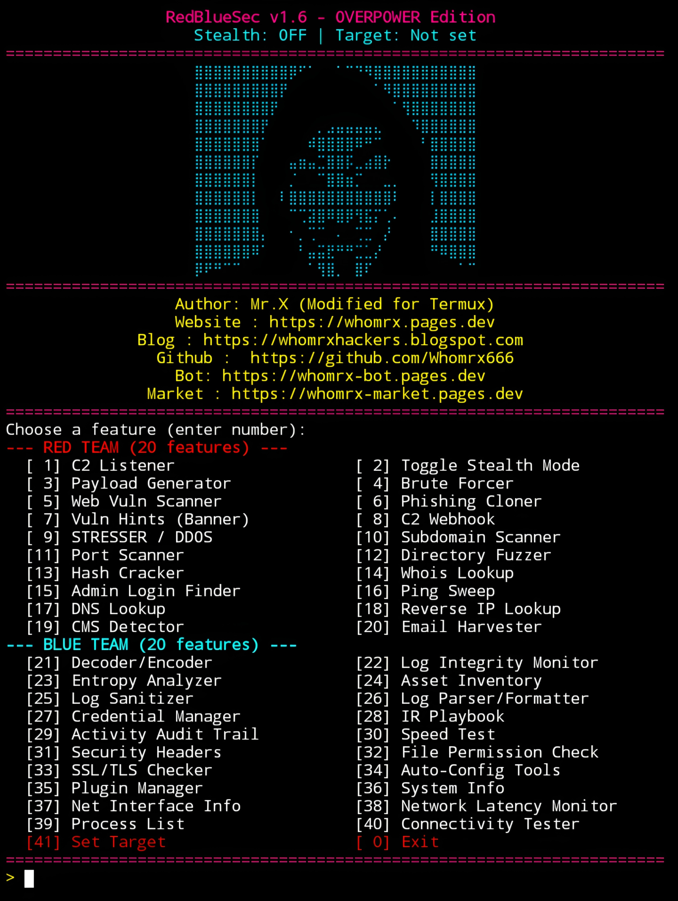

# RedBlueSec v1.6


<p align="center">
  <strong>Red & Blue Team Cyber Security Suite – Overpower Edition</strong><br>
  <em>"Master both sides of the cyber battlefield." – Mr.X</em>
</p>

## Introduction
RedBlueSec v1.6 is a comprehensive cyber security suite that combines **20 Red Team attack tools** and **20 Blue Team defense tools** in one powerful package. Designed for penetration testers, security researchers, and system administrators, it offers everything from C2 listeners, exploit generators, and brute forcers to log analyzers, credential managers, and incident response playbooks. RedBlueSec runs smoothly on **Termux (Android)** without root, as well as Linux and other Unix-like systems. All features automatically use a global target once configured, making multi-tool workflows effortless.

## Installation
```bash
$ pkg update -y && pkg upgrade -y
$ pkg install git python -y
$ pip install colorama requests beautifulsoup4 paramiko pymysql psycopg2-binary speedtest-cli
$ git clone https://github.com/Whomrx666/Redbluesec.git
$ cd Redbluesec
$ python3 install.py
```

## Run manually
```bash
$ python3 redblue.py
```

## Features
- **40 Powerful Features** – 20 Red Team attack tools + 20 Blue Team defense tools.
- **Global Target Scope** – Set target once (feature 41), all tools auto-use it.
- **Stealth Mode** – Toggle user-agent spoofing and minimal logging.
- **C2 Listener & Webhook** – Advanced reverse shell handler with interactive sessions, file upload/download.
- **Payload Generator** – 8 formats: PowerShell, Bash, Python, PHP, Msfvenom, Macro, C binary, Web shell.
- **Brute Forcer** – SSH, FTP, HTTP Basic, MySQL, PostgreSQL + custom wordlist generator.
- **Web Vulnerability Scanner** – XSS, SQLi, LFI detection on forms and URLs.
- **Phishing Cloner** – Clone login pages and capture credentials via HTTP server.
- **Stresser/DDoS Tester** – HTTP GET/POST flood, Slowloris, Random UA flood.
- **Network Recon** – Port scanner, subdomain scanner, ping sweep, DNS lookup, reverse IP, CMS detector.
- **Hash Cracker** – MD5, SHA1, SHA256, SHA512 dictionary attacks.
- **Log Analysis** – Integrity checker, sanitizer, parser/formatter, entropy analyzer.
- **Asset Inventory** – SQLite-backed asset management with network discovery.
- **Credential Manager** – Encrypted vault for storing credentials.
- **Incident Response Playbook** – Interactive step-by-step IR guide.
- **Security Auditing** – Security headers checker, file permissions, SSL/TLS analyzer.
- **System Tools** – System info, network interface, latency monitor, process list, connectivity tester.
- **Decoder/Encoder** – Base64, Hex, URL, HTML, JWT, GZIP, ROT13, XOR, MD5, SHA256, auto-detect.
- **Plugin Manager** – Load and create custom Python plugins.
- **Auto-Config** – Installs required Termux packages and Python libraries.
- **Cyberpunk UI** – Neon colors, ASCII art, loading animation, quick start guide.
- **Termux Optimized** – No root required, fully functional on Android.

## Red Team Features (1–20)
| #  | Feature | Description |
|----|---------|-------------|
| 1  | C2 Listener | Reverse shell handler with interactive sessions |
| 2  | Toggle Stealth Mode | User-agent spoofing and minimal logging |
| 3  | Payload Generator | 8 payload formats for exploitation |
| 4  | Brute Forcer | SSH, FTP, HTTP, MySQL, PostgreSQL attacks |
| 5  | Web Vuln Scanner | XSS, SQLi, LFI detection |
| 6  | Phishing Cloner | Credential harvesting server |
| 7  | Vuln Hints | Banner grabbing and CVE lookup |
| 8  | C2 Webhook | Command & exfil receiver |
| 9  | Stresser/DDoS | HTTP flood testing (authorized only) |
| 10 | Subdomain Scanner | DNS-based subdomain discovery |
| 11 | Port Scanner | Multi-threaded TCP connect scanner |
| 12 | Directory Fuzzer | Hidden path discovery |
| 13 | Hash Cracker | MD5/SHA1/SHA256/SHA512 cracking |
| 14 | Whois Lookup | Domain registration info |
| 15 | Admin Login Finder | Common admin path scanner |
| 16 | Ping Sweep | Host discovery via TCP connect |
| 17 | DNS Lookup | Forward & reverse DNS |
| 18 | Reverse IP Lookup | Find domains hosted on an IP |
| 19 | CMS Detector | WordPress, Joomla, Drupal, Magento |
| 20 | Email Harvester | Extract emails from web pages |

## Blue Team Features (21–40)
| #  | Feature | Description |
|----|---------|-------------|
| 21 | Decoder/Encoder | 11 encoding/decoding operations |
| 22 | Log Integrity Monitor | File change detection via hashing |
| 23 | Entropy Analyzer | Detect encrypted or compressed data |
| 24 | Asset Inventory | SQLite-backed asset management |
| 25 | Log Sanitizer | Pattern-based redaction |
| 26 | Log Parser/Formatter | Syslog, JSON, CSV parsing |
| 27 | Credential Manager | Encrypted credential vault |
| 28 | IR Playbook | Interactive incident response steps |
| 29 | Activity Audit Trail | Tool usage statistics and logs |
| 30 | Speed Test | Network bandwidth measurement |
| 31 | Security Headers Checker | Verify 7 critical headers |
| 32 | File Permission Checker | Detect world-writable, SetUID files |
| 33 | SSL/TLS Checker | Certificate and cipher analysis |
| 34 | Auto-Config Tools | Install Termux packages and pip libraries |
| 35 | Plugin Manager | Load and create custom plugins |
| 36 | System Info | Platform, CPU, memory, disk |
| 37 | Network Interface Info | Show interfaces and IP addresses |
| 38 | Network Latency Monitor | TCP connect latency measurement |
| 39 | Process List | List running processes |
| 40 | Connectivity Tester | HTTP ping and TCP connect test |

## Menu Options
After running the tool, you will see the main menu with options `1` through `41`:
- **Options 1–20** – Red Team features
- **Options 21–40** – Blue Team features
- **Option 41** – Set Target (global target for all tools)
- **Option 0** – Exit

## Instructions
1. **Install** the tool using the commands above.
2. **Run** `python3 redblue.py` to start.
3. **Set a target** – Use option `41` to configure a global target. All tools will automatically use it.
4. **Toggle stealth mode** – Use option `2` to enable user-agent spoofing and minimal logging.
5. **Run Red Team tools** – Select options `1` through `20` for attacks and exploitation.
6. **Run Blue Team tools** – Select options `21` through `40` for defense and analysis.
7. **Auto-configure** – Use option `34` to install required Termux packages and Python libraries.
8. **Exit** – Use option `0` or press Ctrl+C anytime.

## Observation
This tool is intended for **educational and authorized security testing purposes only**. Unauthorized use against systems you do not own or have explicit permission to test is illegal. The author assumes no responsibility for misuse or damage caused by this tool. Always obtain written permission before conducting any security assessment. Use responsibly and ethically.

### Original Author
<a href="https://github.com/Whomrx666"></a>

### <<< If you copy, then give me the credits >>>

## CONNECT WITH ME :

[](https://whomrx.pages.dev)
[](https://whomrxhackers.blogspot.com)
[](https://twitter.com/whomrx666)
[](https://wa.me/6285926601133?text=Halo%2C%20Mr.X)
[](https://www.facebook.com/whomrx.666)
[](https://t.me/Whomr_X)
[](mailto:whomrx666@gmail.com)
[](https://www.tiktok.com/@whomr.x)

**If you want to donate, click on the button**
<a href="https://saweria.co/whomrx"></a>

---

<p align="left">
  
</p>